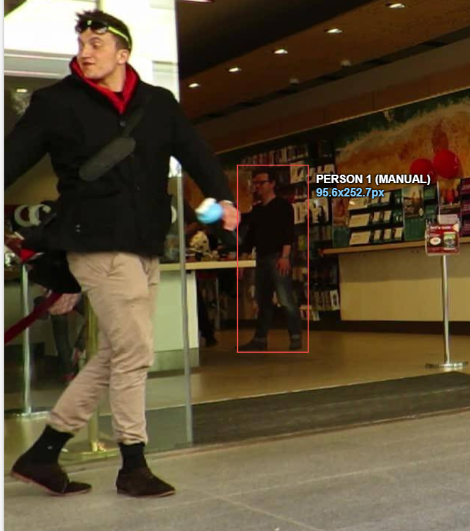
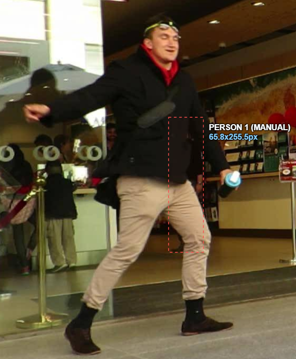
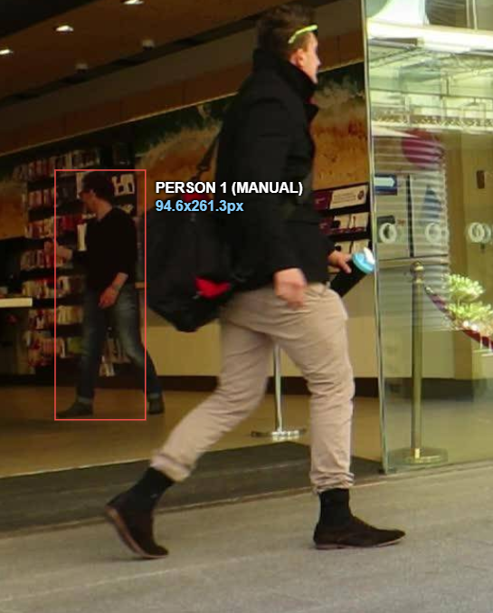

# Báo cáo cá nhân — Nguyễn Thanh Phong — 202603119

Đoạn video: MOT17-09, 150 frame (frame 1–150), nguồn MOTChallenge, giấy phép CC BY-NC-SA 3.0.

## 0. Thông tin học viên

- Họ tên: Nguyễn Thanh Phong
- MSSV: 2A202603119
- Mã đề (A/B/C): B
- Email: 26ai.phongnt5@vinuni.edu.vn
- Link repository: https://github.com/Tphong27/K5-L2-DAY05-NguyenThanhPhong-2A202603119-MOTTracking.git
- Giờ bắt đầu: 16:00
- Giờ kết thúc: 19:00

## 1. Xem trước đoạn video (CP0)

Số frame trong bảng tính theo CVAT, bắt đầu từ 0. Thông tin xuất hiện và che khuất được đối chiếu lại từ hai file export cuối cùng.

| Mã  | Frame xuất hiện | Frame cuối thấy được | Rẽ / dừng / đổi tốc độ ở frame                                                            | Bị che ở frame   | Ghi chú                                                                |
| --- | --------------: | -------------------: | ----------------------------------------------------------------------------------------- | ---------------- | ---------------------------------------------------------------------- |
| P1  |               0 |                  149 | Tăng tốc khoảng 10–20; chậm và đổi hướng khoảng 100–120                                   | 39–49            | Người mặc áo đen trong cửa hàng Vodafone; được xử lý che khuất ở CP2   |
| P2  |               0 |                  149 | Đi từ phải sang trái, tiến gần camera; kích thước đổi rõ khoảng 100–140                   | Không đánh dấu   | Có mặt trong toàn bộ đoạn; box lớn dần khi tới gần camera              |
| P3  |              40 |                  149 | Đi từ mép phải sang trái và tiến gần camera, thay đổi kích thước mạnh từ khoảng frame 100 | Không đánh dấu   | Người đàn ông áo xanh, đội mũ; bắt đầu xuất hiện từ frame 40           |
| P4  |               0 |                  149 | Gần như đứng tại khu vực Woolworths; thay đổi tư thế nhẹ trước frame 110                  | 110–138, 146–149 | Trẻ nhỏ; có hai đoạn được đánh dấu `occluded`                          |
| P5  |               2 |                  149 | Di chuyển ít và đứng gần P4; thay đổi tư thế trước khoảng frame 105                       | 105–149          | Người phụ nữ đứng cạnh P4; bị các đối tượng phía trước che ở cuối đoạn |

## 2. Keyframe và thời gian (CP1, CP4)

Số keyframe lấy từ kết quả `src/check_submission.py`. Trong file CVAT export, ánh xạ là P1 → track 0, P2 → track 1, P3 → track 4, P4 → track 2, P5 → track 3.

| Mã       | Số keyframe | Keyframe ở frame                                                                                                | Số frame có mặt | Keyframe / 100 frame |                    Thời gian (phút) | Chỗ khó                                                              |
| -------- | ----------: | --------------------------------------------------------------------------------------------------------------- | --------------: | -------------------: | ----------------------------------: | -------------------------------------------------------------------- |
| P1       |          28 | 0, 1, 3, 4, 7, 8, 9, 10, 20, 30, 39, 40, 41, 42, 50, 52, 60, 70, 80, 90, 100, 104, 105, 110, 120, 130, 140, 149 |             150 |                 18,7 |                     Không ghi riêng | Giữ box theo người trong cửa hàng và xử lý đoạn bị che ở frame 39–49 |
| P2       |          28 | 0, 1, 3, 4, 5, 7, 8, 9, 10, 11, 20, 30, 40, 42, 50, 60, 70, 80, 90, 100, 104, 105, 110, 120, 130, 136, 140, 149 |             150 |                 18,7 |                     Không ghi riêng | Nhiều điều chỉnh ở các frame đầu và quanh frame 104–105              |
| P3       |          15 | 40, 50, 60, 70, 80, 90, 100, 104, 105, 110, 120, 130, 136, 140, 149                                             |             110 |                 13,6 |                     Không ghi riêng | Xuất hiện muộn từ frame 40                                           |
| P4       |          22 | 0, 1, 3, 4, 5, 7, 9, 10, 11, 20, 30, 40, 50, 60, 80, 100, 104, 110, 139, 140, 144, 146                          |             150 |                 14,7 |                     Không ghi riêng | Đoạn che kéo dài và có nhiều thay đổi trạng thái ở cuối video        |
| P5       |          21 | 2, 3, 4, 5, 6, 7, 8, 9, 10, 20, 30, 40, 50, 80, 100, 105, 106, 107, 108, 109, 110                               |             148 |                 14,2 |                     Không ghi riêng | Xuất hiện từ frame 2; cần chỉnh dày hơn quanh frame 105–110          |
| **Tổng** |     **114** | —                                                                                                               |         **708** |             **16,1** | **180 phút tổng thời gian làm bài** | —                                                                    |

Keyframe / 100 frame của cả bài = 114 ÷ 708 × 100 = **16,1 keyframe / 100 frame**.

P1 và P2 có số keyframe nhiều nhất, cùng 28 keyframe. Với P1, các keyframe tập trung ở đoạn đầu và quanh đoạn bị che để điều chỉnh vị trí box khi người phía trước đi ngang qua. P2 cũng cần nhiều điều chỉnh ở các frame đầu, sau đó các keyframe được đặt thưa hơn ở những đoạn chuyển động ổn định.

## 3. Đoạn bị che (CP2)

Người bị che: `P1` (track 0 trong CVAT export).

| Mốc                                        |                                                Frame |
| ------------------------------------------ | ---------------------------------------------------: |
| Bắt đầu bị che một phần (bật `occluded`)   |                                                   39 |
| Bị che hoàn toàn nhưng vẫn trong khung ảnh | 39–49; tiếp tục dùng `occluded`, không bật `outside` |
| Hiện rõ lại                                |                 50; giữ nguyên cùng track và cùng ID |
| Thấy rõ trở lại (tắt `occluded`)           |                                                   50 |

- Đoạn được đánh dấu `occluded`: **11 frame, từ frame 39 đến frame 49**, tương đương khoảng **0,37 giây** ở 30 fps. P1 vẫn nằm trong khung ảnh nên không sử dụng `outside`.
- Quyết định: **giữ cùng ID**.
- Lý do: `outside` chỉ áp dụng khi đối tượng rời hoàn toàn khỏi khung ảnh. Trong trường hợp này P1 vẫn ở trong ảnh nhưng bị người phía trước che, nên trạng thái phù hợp là `occluded`. Khoảng che chỉ kéo dài 11 frame, ngắn hơn nhiều so với ngưỡng 60 frame; ngoại hình, vị trí xuất hiện lại, hướng đi và tốc độ đều liên tục. Vì vậy P1 được giữ trong cùng một track thay vì tạo ID mới.

Ảnh chụp màn hình:



_Trước đoạn che: P1 còn nhìn thấy rõ bên trong cửa hàng Vodafone._



_Giữa đoạn che: người đi phía trước che P1; box nét đứt thể hiện trạng thái `occluded`._



_Sau đoạn che: P1 hiện rõ trở lại và vẫn thuộc cùng track._

## 4. Tự review ID (CP3)

Tôi đã thực hiện đủ hai lượt review: lượt 1 theo từng người, đi ngược từ frame 149 về frame 0; lượt 2 theo toàn cảnh, nhảy từng 10 frame và tua từng frame tại các đoạn có che khuất hoặc hai người đi gần nhau. Kết quả không phát hiện lỗi ID hay lỗi box rõ ràng còn sót lại trong bản nộp.

| Frame | Mã người | Loại lỗi  | Mô tả một câu                                     | Phát hiện ở lượt | Đã sửa?       |
| ----: | -------- | --------- | ------------------------------------------------- | ---------------- | ------------- |
|     — | P1–P5    | Không lỗi | Đã kiểm hai lượt, không phát hiện lỗi còn sót lại | Cả hai lượt      | Không cần sửa |

Tổng hợp số lỗi theo loại:

| `id_switch` | `fragmentation` | `lost` | `merge` | `false_track` | `drift` | `flag` |
| ----------: | --------------: | -----: | ------: | ------------: | ------: | -----: |
|           0 |               0 |      0 |       0 |             0 |       0 |      0 |

Không có lỗi nào chỉ xuất hiện ở lượt 2. Lượt theo người giúp kiểm tra tính liên tục của từng ID, còn lượt theo cảnh giúp đối chiếu đồng thời cả năm box; hai lượt cho kết quả nhất quán.

## 5. File xuất và kết quả tự kiểm (CP4)

| Kiểm tra                                     | Kết quả                                                                                                           |
| -------------------------------------------- | ----------------------------------------------------------------------------------------------------------------- |
| Tên file MOT 1.1                             | `NguyenThanhPhong_mot.zip`                                                                                        |
| Tên file CVAT for video 1.1                  | `NguyenThanhPhong_cvat_video.zip`                                                                                 |
| Số track ID khác nhau trong `gt/gt.txt`      | 5                                                                                                                 |
| Frame `outside` không có dòng trong `gt.txt` | Đúng theo quy ước; bài này không có đoạn đối tượng rời hoàn toàn khỏi khung ảnh nên không phát sinh mốc `outside` |
| Job đã completed trên CVAT máy cá nhân       | Đúng                                                                                                              |

Kết quả chạy lệnh:

```powershell
.\.venv\Scripts\python.exe src\check_submission.py --mot src\exports\NguyenThanhPhong_mot.zip --cvat src\exports\NguyenThanhPhong_cvat_video.zip
```

```text
Số frame in theo CVAT (bắt đầu từ 0). Trong gt.txt, frame_id = frame CVAT + 1.

=== File MOT 1.1: NguyenThanhPhong_mot.zip ===
  Số track ID: 5   |   Tổng số box: 708
  [OK]        Đúng 5 track ID.

  Track | Frame có mặt | Số frame | Đoạn vắng (outside)
      1 |   0–149      |      150 | -
      2 |   0–149      |      150 | -
      3 |   0–149      |      150 | -
      4 |   2–149      |      148 | -
      5 |  40–149      |      110 | -

=== File CVAT for video 1.1: NguyenThanhPhong_cvat_video.zip ===

  Track | Nhãn   | Frame thấy | Keyframe | KF/100 frame | Frame occluded | Lần bật outside
      0 | person |        150 |       28 |         18.7 |             11 |               0
      1 | person |        150 |       28 |         18.7 |              0 |               0
      2 | person |        150 |       22 |         14.7 |             33 |               0
      3 | person |        148 |       21 |         14.2 |             45 |               0
      4 | person |        110 |       15 |         13.6 |              0 |               0

  Tổng: 114 keyframe / 708 frame có mặt = 16.1 keyframe / 100 frame
  [OK]        Đọc được 5 track từ annotations.xml.

=== Tóm tắt ===
  Lỗi: 0   |   Cảnh báo: 0
  Đạt. Dán phần tóm tắt này vào báo cáo mục 5.
```

Script tự kiểm đọc được đủ năm track, không phát hiện lỗi định dạng hoặc dấu hiệu bất thường theo các ngưỡng tự động. Script không có ground truth nên kết quả này không thay thế bước tự review trực tiếp trên CVAT.

## 6. Ba câu kết

1. Nếu được gán lại, bạn sẽ đặt keyframe khác ở đâu? Vì sao?

   Nếu làm lại, nên giảm các keyframe dư và tập trung tại nơi nội suy dễ sai: P1 bị che ở frame 39–49, thay đổi tốc độ khoảng 100–120, hoặc P2/P3 tiến gần camera khiến kích thước box thay đổi nhanh.

2. Có chỗ nào bạn không chắc "cùng ID hay ID mới"? Bạn đã quyết định và ghi chú thế nào?

   Chỗ tôi phân vân nhất là đoạn P1 bị che ở frame 39–49. Tôi quyết định giữ cùng ID vì đoạn che chỉ kéo dài 11 frame, ngắn hơn nhiều so với ngưỡng 60 frame của lớp. Ngoại hình của P1 trước và sau khi bị che khớp nhau; vị trí xuất hiện lại, hướng đi và tốc độ cũng liên tục. Tôi ghi chú đoạn này là `occluded` và tiếp tục sử dụng cùng track cho P1.

3. Một lỗi ID trong job của bạn (nếu không còn sót, chọn lỗi đã sửa) có thể làm xe tự lái dự đoán sai chuyển động của người đó như thế nào? Lỗi đó ảnh hưởng MOTA hay IDF1 nhiều hơn?

   Nếu xảy ra id_switch, vị trí của cùng một ID có thể nhảy đột ngột sang người khác, làm hệ thống suy ra vận tốc hoặc hướng chuyển động sai. Xe tự lái có thể dự đoán sai quỹ đạo, phanh không cần thiết hoặc phản ứng chậm. id_switch có ảnh hưởng đến MOTA, nhưng nếu ID sai kéo dài qua nhiều frame thì IDF1 giảm mạnh hơn vì IDF1 đo tính nhất quán danh tính trên toàn track.

## Bonus (nếu làm)

Không thực hiện bonus.

## 7. Tài liệu tham khảo và công cụ AI đã dùng

- Tài liệu của bài lab: `README.md`, `RULES.md`, `CHECKPOINTS.md`, `docs/GUIDELINE.md`, `docs/CVAT_CHEATSHEET.md`, `docs/MOT_FORMAT.md` và `SUBMISSION.md`.
- Dữ liệu: MOT17-09, MOTChallenge (Milan et al., 2016), giấy phép CC BY-NC-SA 3.0.
- Công cụ AI: OpenAI Codex được dùng để hướng dẫn thao tác CVAT, giải thích kết quả `src/check_submission.py`, đối chiếu số liệu trong hai file export và hỗ trợ thực hiện bài labs
